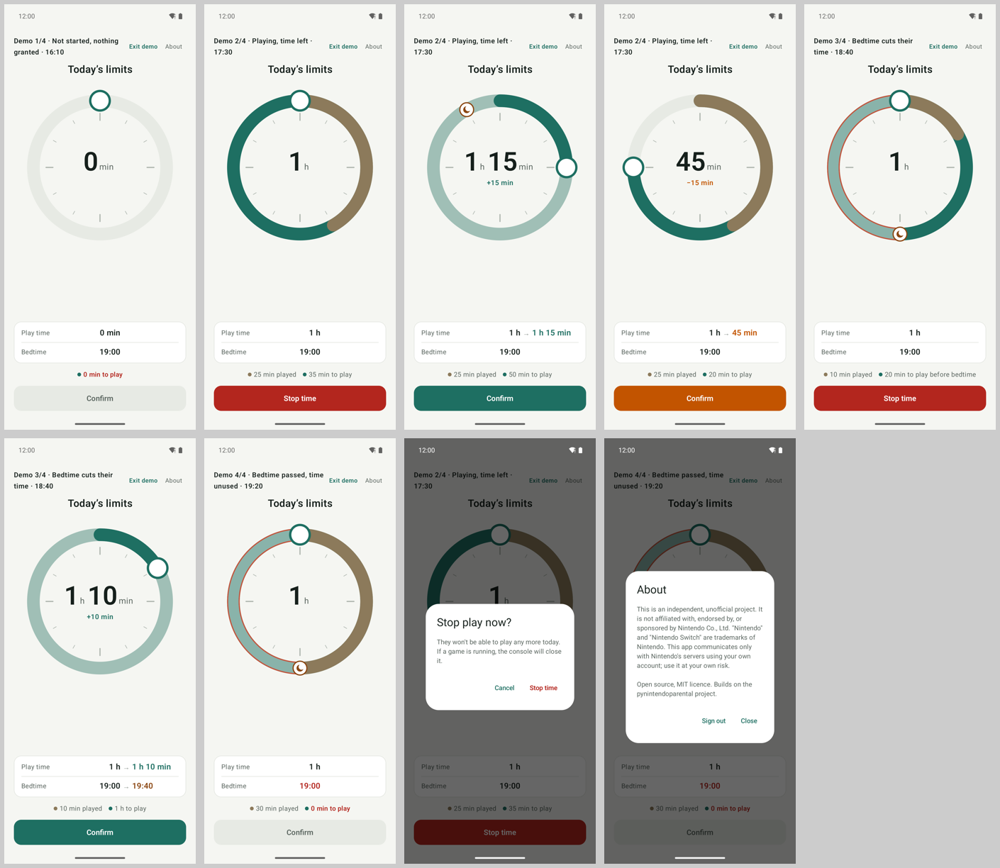

# playtime (working title)

An Android app (iOS later) that gives parents a simpler way to manage today's play time and bedtime: one wheel for today's total, and a preview of exactly what will change before you confirm. It also works around several server-side behaviours that make extensions unreliable. Works with Nintendo Switch Parental Controls.



*Interface, work in progress.*

> This is an independent, unofficial project. It is not affiliated with, endorsed by, or sponsored by Nintendo Co., Ltd. "Nintendo" and "Nintendo Switch" are trademarks of Nintendo. This app communicates only with Nintendo's servers using your own account; use it at your own risk.

## Unofficial API

The app uses the same web API as Nintendo's own parental-controls app, as documented by the open-source [`pynintendoparental`](https://github.com/pantherale0/pynintendoparental) project. That API is not public and can change without notice:

- Using an unofficial client may conflict with Nintendo's terms of service, and Nintendo could restrict your account. The app says so before you sign in and asks you to acknowledge it.
- If Nintendo changes something, the app says "Nintendo's service changed. Update the app, or use the official app for now." instead of guessing. It never tries to work around signing, attestation or other protections.
- The app does nothing the official app doesn't let the account holder do. It only changes today's extension and bedtime, and sends the same amounts the official app offers.

## What it fixes

The server sometimes gives a different result from what was asked: yesterday's extra time added again, an old bedtime coming back, extensions after bedtime that don't let the child play. The app plans each change around these, checks the result with Nintendo after every step, and tells you when it differs. See [docs/BACKEND_ISSUES.md](docs/BACKEND_ISSUES.md) for each behaviour and its workaround, and [docs/DESIGN.md](docs/DESIGN.md) for the design of the screen.

## Status

Working on Android, tested on an emulator against a real account. No release yet: build it from source. A demo mode (header → Demo) shows four typical situations without an account.

## Limitations

- **Today can only be made more generous, not stricter.** Nintendo's API changes a single day only through extra time: the app can add time, move bedtime later, and take back extra time it or the official app granted. It can't give today a lower limit or an earlier bedtime than the weekday setting. For a stricter day, change that weekday's settings in the official app, and change them back afterwards.

## Build and install

Needs JDK 17 and the Android SDK (compileSdk 36; the app runs on Android 8.0+). Point `local.properties` at your SDK (`sdk.dir=/path/to/android-sdk`), then:

```
./gradlew :shared:jvmTest :shared:testDebugUnitTest   # tests
./gradlew :androidApp:installDebug                     # read-only build: shows what it would send, sends nothing
./gradlew :androidApp:installDebug -Pplaytime.writes=true   # can change the console (About shows which build you have)
```

Other tools:

- `PLAYTIME_TOKEN_FILE=/absolute/path/to/session-token ./gradlew :shared:readOnlyCheck` prints today's state for an account, from a session token you already have. It never writes.
- `scripts/screenshots.sh` retakes the demo screenshots and `docs/screenshots/overview.png` on a running emulator.

If Nintendo starts rejecting requests with `invalid_headers`, the minimum app version went up: compare `APP_INTERNAL_VERSION` in `shared/.../config/NintendoApi.kt` with `MOBILE_APP_BUILD` in upstream `pynintendoparental/const.py`.

## Sign-in and credentials

- **Sign-in happens on Nintendo's own page**, in the phone's browser (OAuth with PKCE). Your password never passes through the app. Nintendo redirects back to the app with a one-time code, or you can paste the link if the redirect doesn't work.
- **Only a session token is kept**, encrypted with a key from the Android Keystore, in app storage excluded from backups. Short-lived API tokens are kept in memory only. Sign out (About → Sign out) deletes the token.
- **No server of ours.** The app talks only to Nintendo. There are no analytics, ads or crash reporting.
- **The activity log** (About → Activity log) records each call, its status and timing, for troubleshooting. It never contains tokens, device IDs or names, and it stays on the phone unless you copy it.
- All Nintendo values (client ID, URLs, headers) are in one file, `shared/.../config/NintendoApi.kt`, each with its source.

## Layout

- `shared/`: platform-independent Kotlin: the planner, the API client, sign-in, and the screen model. Shared with iOS later.
- `androidApp/`: the Android app (Jetpack Compose).
- `docs/`: design notes, backend behaviours, screenshots.

## Roadmap

- UX and UI design improvements.
- Availability on the Play Store.
- iOS, later.

## Credits

API knowledge builds on the open-source [`pynintendoparental`](https://github.com/pantherale0/pynintendoparental) project, and refresh timings follow its Home Assistant integration.

## License

MIT, see `LICENSE`.
